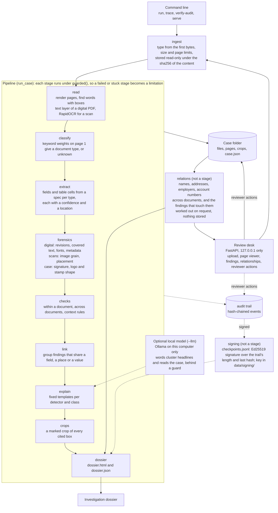

# Architecture

docforensics runs a case (the documents submitted together) through nine stages and writes an audit trail beside it. It runs on one computer with no network access: the OCR models are inside the RapidOCR package, and the only other program it can talk to is an optional language model on the same machine.



## Stages

| Stage | Code | What it does | What it leaves behind |
|---|---|---|---|
| ingest | [ingest.py](../src/docforensics/ingest.py) | Names the type of each file from its first bytes (PDF, PNG, JPEG), applies the size, page and document limits, and stores the file under the sha256 of its content. A file that fails becomes a limitation with a reason | `files/`, the document list |
| read | [read/](../src/docforensics/read/) | Renders every page at a stated resolution and locates its words. A digital PDF is read from its text layer (with font, size and colour), a scan or an image with RapidOCR. Scanned pages get a quality class from their sharpness | `pages/`, words with boxes |
| classify | [understand/classify.py](../src/docforensics/understand/classify.py) | Keyword weights over page 1 give a document type. A page that fits no type, or two equally, stays `unknown` | document type |
| extract | [understand/](../src/docforensics/understand/) | Reads header fields by their label and table cells by their column heading, using a TOML spec per document type. A field that cannot be found is kept, empty, at confidence 0 | fields: value, confidence, location |
| forensics | [forensics/](../src/docforensics/forensics/) | One detector per kind of trace, each on its own under `guarded()`. Digital PDFs: saved revisions, covered or hidden text, fonts of figures and dates, file metadata. Scans: image grain and placement of words. Across the case: shape of the signature, the logo and the stamp | observations and limitations |
| checks | [checks/](../src/docforensics/checks/) | Within a document: balance chain, dates, totals, net pay against its words, weekday. Across documents: name, address, employer, account, net pay against the bank, income, dates, duplicates, producing software. Context rules against a synthetic reference | inconsistencies, observations, limitations |
| link | [link.py](../src/docforensics/link.py) | Groups findings that cite the same field, lie on the same place of a page, or concern the same name, address, employer or account. A group with two or more independent kinds of check gets a headline finding | clusters |
| explain | [explain/](../src/docforensics/explain/) | Fixed wording per detector and class, with next steps. If a local model is given, it words the headline of each cluster instead, when the guard accepts what it says, and reads the case once for relations between findings, a summary and a reading order | explanation, next steps, source of the wording, the model's reading |
| crops | [evidence.py](../src/docforensics/evidence.py) | Cuts out the part of the page that each finding cites and outlines the cited box | `crops/` |
| dossier | [dossier.py](../src/docforensics/dossier.py) | Writes the dossier twice from one dict: `dossier.json` for machines and a self-contained `dossier.html` (crops embedded, no script, nothing fetched). It records the length and last hash of the audit trail | `dossier.html`, `dossier.json` |

A stage that raises an error, or does not finish in its time limit, is written to the audit trail and shown as a limitation. The run goes on with what it has. A step stuck in native code is abandoned, not killed.

The entity relationship view ([relations.py](../src/docforensics/relations.py)) is not a stage. It is worked out from the case when the dossier is written and when the review desk's Relationships tab asks for it, it stores nothing, and it leaves the case as it was. It lists the names, addresses, employers and account numbers the documents write (two writings are one entity when the cross-document checks grade them as the same, or the same apart from form), the places where each is written, and the findings that cite one of those fields or lie over one of those places. The headline of a group of findings and limitations are left out. No model takes part.

## Findings

- Every finding has a class: **observation** (something seen, which unaltered documents can show too), **inconsistency** (two things that should agree do not, by a stated measure and tolerance), **potential manipulation** (only the headline of a cluster: independent kinds of check point at one place, which is a priority for review and not a probability) or **processing limitation** (a step could not run in full, so what it would have shown is unknown).
- Every finding carries evidence: the document, the page (0 for the document as a whole), the box in pixels of the page rendered at its stated resolution, and where it applies the value and a crop. `trace` also prints the box in points and checks the stored file against its sha256.
- The tool states no conclusion about authenticity or intent. The explanation names what was measured and what else could cause it. A reviewer can mark a finding open, needing verification, confirmed by the reviewer or dismissed, and add a note; nothing the tool does moves a finding to confirmed, and each action is an audit event.

## What is deterministic, and what is not

Digits, arithmetic, dates, revision differences and shapes are measured by code, not by a model, and so is the sorting of writings into entities for the relationship view. The explanation of a finding is fixed wording from [explain/templates.py](../src/docforensics/explain/templates.py).

The one place a model can take part is the explain stage, and only if one is given to the run (`--llm`). It does two things. It words the headline of a cluster ([explain/llm.py](../src/docforensics/explain/llm.py)), and it reads the case once and suggests relations between findings, a short summary and an order to read them in ([explain/reason.py](../src/docforensics/explain/reason.py)). It is given structured findings (ids, kinds of check, titles, the values the checks used), never page text, a finding's detail or a box. It adds, ranks and explains; it cannot change, confirm, remove or add a finding, and the order it returns always holds every finding once.

[explain/guard.py](../src/docforensics/explain/guard.py) judges each part alone. The wording, the summary and the reason of a relation must cite only the ids the model was given, state no number or date that those findings do not hold, and pass no verdict. A relation of kind same_value, same_field or same_document is also kept only if its two findings cite a common figure, field or document (follows_from is a judgement and stays inference). What fails is dropped, kept with the reading as dropped, and the template wording stays. What is used is labelled "AI-generated wording (inference)" or "AI reading of the case (inference)", and each call, accepted or not, is an audit event with the model, its digest and the hashes of what went in and out. The client talks to a loopback address and refuses any other host. A call starts only if its timeout fits in the time the stage has left, and a reply is cut at 1024 tokens. The guard checks ids, figures, dates and verdict words, not meaning; the capability table in the [README](../README.md) and limitation 30 say what was measured and what was not.

## Case folder and audit trail

```
data/cases/C-<date>-<time>-<4 hex>/
    files/         the original files, named by sha256, read-only
    pages/         D1-p1.png, D1-p2.png, ...
    crops/         F-001-1.png, ... (finding, evidence)
    case.json      documents, pages, words, fields, findings, reviewer actions
    audit.jsonl    one JSON event per line, each carrying the hash of the one before
    checkpoints.jsonl  signed checkpoints of that trail, one JSON line each
    dossier.html
    dossier.json
data/signing/
    private.pem, public.pem   the Ed25519 key of this data folder, outside the case folders
```

There is no database. [audit.py](../src/docforensics/audit.py) hashes each event together with the previous hash, so editing or removing a line breaks the chain from that point on; `verify-audit` checks it. Truncating the end of the file cannot be seen from the file alone, which is why the dossier records the trail's length and last hash as an outside anchor.

[signing.py](../src/docforensics/signing.py) goes further, as far as a key can. At the end of a run and around the building of its dossier it signs the case id, the number of events, the last hash and the time with an Ed25519 key, and adds the result as one line to `checkpoints.jsonl`; a reviewer action after that adds a checkpoint to the same chain. Only a run begins a chain: an action on a case that has no checkpoints (never run, or `checkpoints.jsonl` removed) signs nothing. The trail gets no new event for it, so the events of a run are the same with or without signing. `verify-audit` checks each checkpoint against the trail: the signature, the case, that the trail is at least as long as the checkpoint says, and that the event at the signed position still has the signed hash. An event changed with every later hash worked out again fails the last check, and a trail cut at the end fails the length check. Events after the last checkpoint are counted as not covered. Nothing is signed on top of a trail whose own chain fails, of checkpoints that no longer hold against the trail (a bad signature, another case, a trail cut or rewritten at a signed position, a line that is not a checkpoint), or with a key other than the one that signed them. A signing that is refused or fails (no folder to write the key in, a damaged key file) never stops the run: it becomes a `checkpoint_failed` event that gives the reason and no file path. The checkpoints are not linked to each other, so the last ones can be deleted together with the events they cover; what is left still holds, and the next action signs it.

The key is made the first time it is needed, one per data folder, as `data/signing/private.pem` (PKCS#8, no password; the file is set to owner-only where the system honours that) with `public.pem` beside it. It is kept outside the case folders so that a case can be shared without it. A checkpoint names its own public key, and whoever can read the data folder can change a trail, chain it again and sign it with a key of their own, so "some key signed this" is all a checkpoint shows by itself. A reader who needs more takes the public key from somewhere else and gives it to `verify-audit --pubkey`. The time in a checkpoint is the clock of the signing machine, with no timestamp authority. It is a check of integrity, not a certification; no SOC 2 or ISO/IEC 27001 claim is made.

## Trust boundaries

- The review desk binds `127.0.0.1`, answers only requests whose Host is a loopback name, refuses a write whose Origin differs, and sends a content security policy that forbids loading anything from elsewhere. Names in a URL are validated before any path is built from them.
- Uploaded files are typed by their first bytes, limited in size, pages and number, and stored by hash, so a user-supplied file name never becomes a path.
- Text taken from a document reaches the dossier HTML only after control and bidirectional characters are stripped and it is escaped, reaches the review desk page as text and never as markup, and reaches the terminal through one-line quoting.
- Files are opened by PDF and image parsers in the same process as the tool. There are limits on size, pages and time, and there is no sandbox. That is a stated limitation, see [limitations](limitations.md).

## Comments in the code

A comment such as "design 7.4" points to the author's design notes, which are not published. This page, the README and [limitations](limitations.md) describe the same design.
